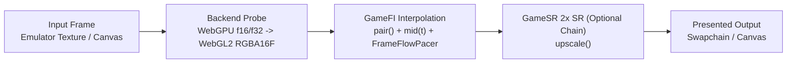

<h1 align="center">FrameFlow · Cross-Browser Optical-Flow Interpolation &amp; Super-Resolution Suite</h1>

<p align="center">
  <a href="LICENSE"></a>
  <a href="pyproject.toml"></a>
  <a href="package.json"></a>
  <a href="https://frameflow.cbnv.me/en/"></a>
</p>

<p align="center">
  <a href="README.md">简体中文</a> | <strong>English</strong>
</p>

<p align="center">
  <a href="https://frameflow.cbnv.me/en/docs/">Online Docs</a> · <a href="docs-site/en/api-reference/index.md">API &amp; Format Reference</a> · <a href="repo-docs/README.md">Source Guide (ZH)</a> · <a href="https://github.com/CyberNova2333/frameflow/releases">Pre-trained Releases</a>
</p>

**FrameFlow** is a cross-browser neural video enhancement workflow suite built for web browsers and web emulators such as PVSSPW and PPSSPW. It encompasses two model families — **GameFI** (optical-flow frame interpolation) and **GameSR** (real-time 2× super-resolution) — running via a **compact unified graph format (`graph.json` + `model.json` + `model.bin`)** on a **zero-dependency, zero-WASM WebGPU / WebGL2 dual-backend ES module runtime**.

## Capability Scope & Explicit Non-Goals

- **What it delivers**:
  - Zero-dependency, zero-WASM browser runtime (WebGPU Compute with `f16` / automatic `f32` fallback, seamlessly falling back to WebGL2 `RGBA16F` + MRT fragment shaders) verified to **69–72 dB PSNR** (GameFI) and **62–63 dB PSNR** (GameSR-2x) numerical parity against PyTorch in headless Edge 157 (Intel Xe-LPG);
  - Zero-copy context sharing for external `GPUDevice` (PVSSPW) and `WebGL2RenderingContext` (PPSSPW), supporting arbitrary phase `t ∈ (0, 1)` interpolation (`2×` / `3×`), synthetic static-HUD zero-flow supervision, and standalone or chained GameFI + GameSR execution;
  - Clean open-licensed training dataset preparation, distillation, visual evaluation, and SHA-256 release packaging pipelines.
- **What it explicitly does NOT do**:
  - **Zero binary weights or non-commercial media in Git**: `.bin` / `.pt` artifacts and training clips stay gitignored and are distributed solely via GitHub Releases / CNB OCI alongside `DATA_PROVENANCE.json` and license texts;
  - **No CPU / WASM fallback**: When neither WebGPU nor WebGL2 half-float/float FBOs are supported, `probeCapabilities()` / `createFrameFlow()` reports unsupported gracefully instead of starving emulator threads;
  - **`GameSR-2x` is fixed to 2× scaling with zero hot-path readback**: Arbitrary non-2× scale factors are unsupported, and the pacer never performs blocking synchronous `mapAsync` readbacks during frame pacing.

## Workflow Architecture



## Model Specs & Measured Parity (Intel Xe-LPG)

All hidden channel counts are multiples of 4 to match WebGPU vectorization and WebGL2 `RGBA16F` texture packing:

| Task | Preset | Model Name | Params | f16 Size | Target Role |
|---|---|---|---:|---:|---|
| Interpolation (`interp`) | `std` | `GameFI-Std` | 775,811 | ~1.52 MB | Desktop iGPU/dGPU & flagship mobile WebGPU |
| Interpolation (`interp`) | `lite` | `GameFI-Lite` | 222,179 | ~434 KB | Universal WebGL2, mid-tier mobile, PSP `1x/2x` |
| Super-Res (`sr`, 2×) | `sr_std` | `GameSR-Std` | 11,548 | ~22.6 KB | High-detail 2× anti-aliasing & edge crispening |
| Super-Res (`sr`, 2×) | `sr_lite` | `GameSR-Lite` | 6,936 | ~13.5 KB | Ultra-lightweight 2× SR for WebGPU / WebGL2 |

**Headless Edge 157 (Intel Xe-LPG, GPU fence enabled) numerical parity & latency**:

| Backend | Model | PyTorch Parity PSNR | Max Pixel Diff | `960×544` (`int 480×288`) / `480->960` | PSP `480×272` / `960->1920` |
|---|---|---:|---:|---:|---:|
| **WebGPU** | `GameFI-Std` | **72.32 / 71.70 dB** (`t=0.5` / `1/3`) | 1 / 255 | **20.81 ms** (12.81 + 3.88) | — |
| **WebGPU** | `GameFI-Lite` | **72.12 / 72.56 dB** (`t=0.5` / `1/3`) | 1 / 255 | **10.13 ms** (6.53 + 5.25) | **7.02 ms** |
| **WebGL2** | `GameFI-Std` | **69.55 / 69.38 dB** (`t=0.5` / `1/3`) | 1 / 255 | **40.21 ms** | — |
| **WebGL2** | `GameFI-Lite` | **71.05 / 71.33 dB** (`t=0.5` / `1/3`) | 1 / 255 | **15.14 ms** | **43.27 ms** |
| **WebGPU** / **WebGL2** | `GameSR-Lite` | **63.48 / 63.48 dB** | 1 / 255 | **25.6 / 32.4 ms** | **45.5 / 54.4 ms** |
| **WebGPU** / **WebGL2** | `GameSR-Std` | **62.52 / 62.52 dB** | 1 / 255 | **16.1 / 33.1 ms** | **53.0 / 79.8 ms** |

## Quick Browser Integration

```js
import { createFrameFlow, loadModelFromUrl } from 'frameflow/runtime';

const engine = await createFrameFlow({ backend: 'auto' }); // Or pass { device } / { gl }
const fiModel = await loadModelFromUrl(engine, '/assets/models/gamefi-lite/');
const session = engine.createSession(fiModel, {
  width: 960,
  height: 544,
  internal: [480, 288],
  k: 1,
  stillGuard: true,
});

session.pushFrame(0, frameACanvas);
session.pushFrame(1, frameBCanvas);
session.pair(0, 1);
session.mid(0.5, 0);

const srModel = await loadModelFromUrl(engine, '/assets/models/gamesr-lite/');
const srSession = engine.createSession(srModel, { width: 480, height: 272 });
srSession.pushFrame(0, srcCanvas);
srSession.upscale(0, 0); // Produces 960x544 output in slot 0
```

## Documentation & Release Artifacts

- Pre-trained weights are published on [GitHub Releases](https://github.com/CyberNova2333/frameflow/releases) (`weights-v0.1.0` for `GameFI`, `sr-weights-v0.1.0` for `GameSR`).
- See [Integration Guide (`docs/INTEGRATION.md`)](docs/INTEGRATION.md), [Training Guide (`docs/TRAINING.md`)](docs/TRAINING.md), [`CONTRIBUTING.md`](CONTRIBUTING.md), [`SECURITY.md`](SECURITY.md), and [`AGENTS.md`](AGENTS.md).

```bash
make env-check      # Verify Python, PyTorch CUDA/bf16, ffmpeg
make test           # Run fast CPU Python unit tests + Node runtime tests
make verify-runtime # Verify WebGPU & WebGL2 numerical parity on local GPU
```

## License & Additional Terms

- First-party source code and self-trained model weights are licensed under [GNU AGPLv3](LICENSE) (`AGPL-3.0-only`).
- **Additional Terms & Asset Rules**: Subject to [`LICENSE-ADDITIONAL_TERMS-zh-CN.md`](LICENSE-ADDITIONAL_TERMS-zh-CN.md) (v1.6.7-r4, authoritative Chinese text; English reference translation in [`LICENSE-ADDITIONAL_TERMS-en.md`](LICENSE-ADDITIONAL_TERMS-en.md)) under GNU AGPLv3 Section 7. See [`IMPLEMENTATION-GUIDE.zh-en.md`](IMPLEMENTATION-GUIDE.zh-en.md) for engineering guidance and [`ASSETS_LICENSES.md`](ASSETS_LICENSES.md) for contributor, AI tool, third-party dependency, open-licensed media dataset, and identifier disclosures.
