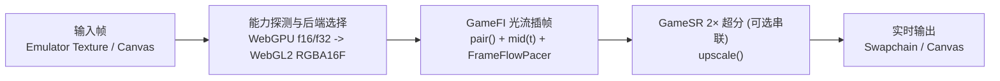

<h1 align="center">FrameFlow · 跨浏览器光流插帧与超分工作流套件</h1>

<p align="center">
  <a href="LICENSE"></a>
  <a href="pyproject.toml"></a>
  <a href="package.json"></a>
  <a href="https://frameflow.cbnv.me/docs/"></a>
</p>

<p align="center">
  <strong>简体中文</strong> | <a href="README.en.md">English</a>
</p>

<p align="center">
  <a href="https://frameflow.cbnv.me/docs/">在线文档站</a> · <a href="docs-site/api-reference/index.md">API 与格式参考</a> · <a href="repo-docs/README.md">源码指南</a> · <a href="https://github.com/CyberNova2333/frameflow/releases">Release 权重下载</a>
</p>

**FrameFlow** 是面向浏览器与网页模拟器（如 PVSSPW、PPSSPW）的跨浏览器实时画面工作流套件，旗下包含 **GameFI**（光流 AI 插帧）与 **GameSR**（2× AI 实时超分）两个模型家族，采用 **统一紧凑权重格式（`graph.json` + `model.json` + `model.bin`）** 与 **零依赖、零 WASM 的 WebGPU / WebGL2 双后端自动降级运行时**。

## 能力边界与明确非目标

- **能做到什么程度**：
  - 提供零 npm 依赖、零 WASM 的浏览器运行时（WebGPU Compute 优先、`f16` 自动降 `f32`；自动回退 WebGL2 `RGBA16F` + MRT），在无头 Edge 157（Intel Xe-LPG）下与 PyTorch 参考实现的数值对齐达 **69–72 dB PSNR**（GameFI）与 **62–63 dB PSNR**（GameSR-2x）；
  - 支持外部 `GPUDevice`（PVSSPW）与 `WebGL2RenderingContext`（PPSSPW）同设备/同上下文零拷贝接入，原生支持任意相位 `t ∈ (0, 1)`（`2×` 与 `3×`）、静态 HUD zero-flow 保护以及 GameFI + GameSR 串联执行；
  - 仓库提供 100% 开放许可训练数据切分、训练/蒸馏/评测脚本与全自动 SHA-256 合规打包发版流水线。
- **明确不做什么**：
  - **绝不向 Git 仓库提交二进制权重或非商业训练素材**：`*.bin` / `*.pt` 与原始媒体全部保留在 `.gitignore` 外，权重仅经 Release / OCI 配合完整 `DATA_PROVENANCE.json` 单独分发；
  - **不做 CPU / WASM 软推理兜底**：设备不支持 WebGPU 且不支持 WebGL2 浮点/半浮点渲染目标时，直接报告不支持，避免抢占模拟器 CPU 资源；
  - **`GameSR-2x` 固定为 `2×` 超分、热路径零同步回读**：不支持任意非 `2×` 缩放比例，推理节拍器不在热路径触发阻塞式 `mapAsync` 回读。

## 工作流与推理架构



## 模型规格与实测基准

所有隐藏层通道数均为 4 的倍数，同时适配 WebGPU 向量化计算与 WebGL2 `RGBA16F` 四通道纹理打包：

| 任务 | 预设 | 模型名 | 参数量 | f16 权重体积 | 典型定位 |
|---|---|---|---:|---:|---|
| 插帧 (`interp`) | `std` | `GameFI-Std` | 775,811 | ~1.52 MB | 桌面核显/独显 WebGPU、旗舰移动 WebGPU |
| 插帧 (`interp`) | `lite` | `GameFI-Lite` | 222,179 | ~434 KB | WebGL2 全浏览器兜底、中端移动端、PSP `1x/2x` |
| 超分 (`sr`, 2×) | `sr_std` | `GameSR-Std` | 11,548 | ~22.6 KB | 高画质 2× 去锯齿与轮廓锐化，可单开或接在 GameFI 之后 |
| 超分 (`sr`, 2×) | `sr_lite` | `GameSR-Lite` | 6,936 | ~13.5 KB | 超轻量 2× 超分（WebGPU / WebGL2 高帧率推荐） |

**Intel Xe-LPG 核显（无头 Edge 157，带真实 GPU 完成栅栏）实测对齐与耗时**：

| 后端（零 WASM 纯 JS/Shader） | 模型 | PyTorch 对齐 PSNR | 最大像素差 | `960×544`（`int 480×288`） / `480->960` | PSP `480×272` / `960->1920` |
|---|---|---:|---:|---:|---:|
| **WebGPU**（`f16` 自动降 `f32`） | `GameFI-Std` | **72.32 / 71.70 dB**（`t=0.5` / `1/3`） | 1 / 255 | **20.81 ms**（12.81 + 3.88） | — |
| **WebGPU**（`f16` 自动降 `f32`） | `GameFI-Lite` | **72.12 / 72.56 dB**（`t=0.5` / `1/3`） | 1 / 255 | **10.13 ms**（6.53 + 5.25） | **7.02 ms** |
| **WebGL2**（`RGBA16F` + MRT） | `GameFI-Std` | **69.55 / 69.38 dB**（`t=0.5` / `1/3`） | 1 / 255 | **40.21 ms** | — |
| **WebGL2**（`RGBA16F` + MRT） | `GameFI-Lite` | **71.05 / 71.33 dB**（`t=0.5` / `1/3`） | 1 / 255 | **15.14 ms** | **43.27 ms** |
| **WebGPU** / **WebGL2** | `GameSR-Lite` | **63.48 / 63.48 dB** | 1 / 255 | **25.6 / 32.4 ms** | **45.5 / 54.4 ms** |
| **WebGPU** / **WebGL2** | `GameSR-Std` | **62.52 / 62.52 dB** | 1 / 255 | **16.1 / 33.1 ms** | **53.0 / 79.8 ms** |

## 浏览器端快速接入

```js
import { createFrameFlow, loadModelFromUrl, FrameFlowPacer } from 'frameflow/runtime';

// 自动按 WebGPU -> WebGL2 降级；也可传入 { device }（PVSSPW）或 { gl }（PPSSPW）实现零拷贝共享
const engine = await createFrameFlow({ backend: 'auto' });
const fiModel = await loadModelFromUrl(engine, '/assets/models/gamefi-lite/');
const session = engine.createSession(fiModel, {
  width: 960,
  height: 544,
  internal: [480, 288], // 核显 / WebGL2 推荐档位；PSP 1x (480x272) 可用 'frame'
  k: 1,
  stillGuard: true,
});

// 喂入游戏帧（支持 HTMLCanvasElement / OffscreenCanvas / ImageBitmap / Uint8Array 或外部纹理）
session.pushFrame(0, frameACanvas);
session.pushFrame(1, frameBCanvas);
session.pair(0, 1);
session.mid(0.5, 0); // 生成 t=0.5 中间帧至 output slot 0

// 可选：独立加载 GameSR-2x 执行 2× 锐化超分
const srModel = await loadModelFromUrl(engine, '/assets/models/gamesr-lite/');
const srSession = engine.createSession(srModel, { width: 480, height: 272 });
srSession.pushFrame(0, srcCanvas);
srSession.upscale(0, 0); // 输出 960x544 至 output slot 0
```

## 文档导航

- [**浏览器与模拟器接入指南** (`docs/INTEGRATION.md`)](docs/INTEGRATION.md)：PVSSPW（WebGPU 共享设备零拷贝）、PPSSPW（WebGL2 共享上下文零拷贝）与通用 Canvas 集成
- [**训练与双端发版指南** (`docs/TRAINING.md`)](docs/TRAINING.md)：CNB 48GB 云端 GPU 一键训练、GitHub Actions 流水线、本地 RTX 训练与 Release 权重发布
- [**协作者指南** (`CONTRIBUTING.md`)](CONTRIBUTING.md) · [**安全说明** (`SECURITY.md`)](SECURITY.md) · [**Agent 协作约定** (`AGENTS.md`)](AGENTS.md)

## 目录结构

```text
frameflow/
├── .cnb.yml                     # CNB 云原生构建：push/PR CI + 48GB GPU 训练直发 OCI 制品流水线
├── .cnb/web_trigger.yml         # CNB 分支详情页自定义按钮（一键选档位/步数/推送 OCI 制品）
├── .github/workflows/
│   ├── ci.yml                   # GitHub Actions CI：Python 模型 + Node 运行时单元测试
│   └── train-and-release.yml    # GitHub Actions 手动训练直发 Workflow Artifact（可选 GitHub Release）
├── docs/
│   ├── TRAINING.md              # CNB GPU / GitHub Actions / 本地训练与权重发布说明
│   └── INTEGRATION.md           # PVSSPW / PPSSPW / 浏览器通用接入说明
├── runtime/                     # 零依赖、零 WASM 浏览器推理后端（WebGPU + WebGL2 + Pacer + TS 类型）
│   ├── index.js                 # 统一入口 createFrameFlow() 与能力探测 probeCapabilities()
│   ├── loader.js                # 共享模型解析、校验、静态图编译与 FiLM MLP
│   ├── webgpu-backend.js        # 纯 WGSL WebGPU Compute 后端（自动 f16/f32，支持共享 GPUDevice）
│   ├── webgl2-backend.js        # 纯 GLSL ES 3.00 WebGL2 后端（RGBA16F TEXTURE_2D_ARRAY + MRT，支持共享 GL）
│   ├── pacer.js                 # 无回读阻塞 2x/3x 实时帧节拍器
│   └── types.d.ts               # 完整 TypeScript 声明
├── frameflow/                   # GameFI (FrameFlowNet 兼容别名) 与 GameSR PyTorch 模型、损失、导出器
├── scripts/
│   ├── prepare_data.py          # 下载 GameFI 所需 CC-BY / 开源 50-60fps 视频并切分 train/val
│   ├── prepare_sr_data.py       # 准备 GameSR 2× 超分训练数据（CC-BY / Xiph / SYNLA MIT / 合成 HUD）
│   ├── train.py / train_sr.py   # bf16 训练、验证、知识蒸馏与权重自动导出
│   ├── package_release.py       # 打包权重压缩包（gamefi-* / gamesr-*）、SHA256SUMS.txt 与 RELEASE_NOTES.md
│   ├── publish_github_release.sh# 自动创建/更新 GitHub Release 并上传全部权重（支持 gh 或 GITHUB_TOKEN）
│   ├── eval_pairs.py / eval_sr_visual.py  # 真实游戏连续帧与超分视觉评测及对比图生成
│   ├── verify_backends.py/.mjs  # GameFI WebGPU + WebGL2 双后端数值对齐与基准
│   ├── verify_sr_backends.py/.mjs # GameSR-2x WebGPU + WebGL2 双后端数值对齐与基准
│   └── verify_parity.py/.mjs    # 与参考 WebGPU 引擎对齐校验
├── tests/                       # 快速 CPU Python 单元测试 + Node 运行时加载与节拍器测试
├── Makefile
├── package.json
├── pyproject.toml
├── meta.json
├── AGENTS.md
├── CLAUDE.md
├── CONTRIBUTING.md
├── SECURITY.md
├── LICENSE                      # GNU AGPLv3 (AGPL-3.0-only)
├── LICENSE-ADDITIONAL_TERMS-zh-CN.md  # AGPLv3 第 7 条附加条款（v1.6.7-r4 简体中文正文）
├── LICENSE-ADDITIONAL_TERMS-en.md     # 附加条款英文参考译文
├── IMPLEMENTATION-GUIDE.zh-en.md      # 附加条款工程实施指南
└── ASSETS_LICENSES.md           # 人员署名、AI 工具、依赖与资产四分区清单
```

## 双端云训练与制品发布

仓库不提交二进制权重文件（`.bin` / `.pt`），已训练权重可直接从 [**GitHub Releases**](https://github.com/CyberNova2333/frameflow/releases) 下载（`weights-v0.1.0` 为 `GameFI`，`sr-weights-v0.1.0` 为 `GameSR`），流水线也可重新触发生成：

1. **CNB 48GB GPU 云端一键训练 → OCI 制品库**：
   - 在 CNB 仓库 `main` 分支详情页点击自定义按钮 **「48GB GPU 训练并发布权重制品」**（由 [`.cnb/web_trigger.yml`](.cnb/web_trigger.yml) 与 [`.cnb.yml`](.cnb.yml) 驱动），在 `cnb:arch:amd64:gpu` 上训练 `GameFI-Std` 并蒸馏 `GameFI-Lite`，通过 `oras push` 推送至 CNB OCI 制品库。
2. **GitHub Actions 训练 → Workflow Artifact（可选 GitHub Release）**：
   - 在 GitHub **Actions → Train & Publish Weights Artifact** 手动触发 [`.github/workflows/train-and-release.yml`](.github/workflows/train-and-release.yml)。
3. **本地 RTX 独显训练 + 一键发版**：

```bash
# 0. 检查环境、CPU 单元测试与双后端对齐
make env-check
make test
make verify-runtime

# 1. 下载并切分 100% 合规 CC-BY / 开源 50-60fps 训练素材
make data-starter

# 2. 训练 GameFI-Std（100K 步）与蒸馏 GameFI-Lite（50K 步）
make train-std
make train-lite

# 3. 打包并发布权重到 GitHub Release
make eval-game
make package-release RELEASE_TAG=weights-v0.1.0
make publish-github RELEASE_TAG=weights-v0.1.0
```

详细参数与 Release 产物清单见 [**`docs/TRAINING.md`**](docs/TRAINING.md)。

## 许可证与附加条款

- 本项目第一方自研代码与自训权重依据 [GNU AGPLv3](LICENSE)（`AGPL-3.0-only`）条款发布。
- **附加条款与资产规则**：本项目依据 GNU AGPLv3 第 7 条适用 [`LICENSE-ADDITIONAL_TERMS-zh-CN.md`](LICENSE-ADDITIONAL_TERMS-zh-CN.md)（v1.6.7-r4；英文参考译文：[`LICENSE-ADDITIONAL_TERMS-en.md`](LICENSE-ADDITIONAL_TERMS-en.md)，以简体中文完整版正文为准），对来源陈述、修改标识、禁止冒充、扩展模块有条件附加许可及项目标识边界作出补充说明；工程落地参考见 [`IMPLEMENTATION-GUIDE.zh-en.md`](IMPLEMENTATION-GUIDE.zh-en.md)，人员署名、AI 辅助工具、外部依赖与公开训练数据来源及项目标识综合清单见 [`ASSETS_LICENSES.md`](ASSETS_LICENSES.md)。附加要求与第 9.5–9.6 款附加许可豁免均分别核实相应版权持有人有效授权，未取得该等授权的第三方材料仍受其原有有效许可约束。
