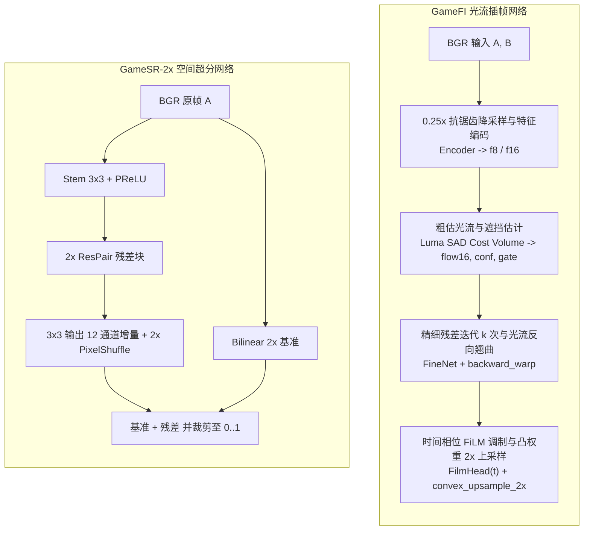

# GameFI 与 GameSR 模型及静态图格式

FrameFlow 套件把实时画面增强拆分为两个职责正交的模型家族：`GameFI` 负责时间域光流插帧，`GameSR` 负责空间域二倍超分。两者采用完全相同的参数存储格式与计算图拓扑描述，从而共享同一套前端解析器与执行引擎。

## 命名边界与向后兼容别名

在代码与文档中使用统一的两层命名规范：
- **套件与运行时名称**：`FrameFlow` 指整个训练框架、紧凑权重格式以及浏览器端统一运行库。
- **光流插帧模型**：对外模型名称统一为 `GameFI`（分为 `GameFI-Std` 与 `GameFI-Lite`）。为避免破坏已有下游引用，Python 包在初始化模块保留 `GameFINet = FrameFlowNet`、`GameFILoss = FrameFlowLoss` 别名；导出清单内的 `meta.model` 写入 `GameFI-Std` 或 `GameFI-Lite`。
- **实时超分模型**：模型名称为 `GameSR`（分为 `GameSR-Std` 与 `GameSR-Lite`，配置别名支持传入 `std` 或 `lite` 自动映射至 `sr_std` 与 `sr_lite`）。

对应源码：[模块导出入口](../../frameflow/__init__.py) 与 [插帧配置](../../frameflow/config.py)。

## 四通道对齐设计与预设规格对比

为保证 WebGL2 后端在片元着色器中能够以四通道 `RGBA16F` 纹理无缝打包每一层中间特征，避免零散通道拆包导致额外的采样指令，两套模型配置在 `__post_init__` 构造阶段就以代码断言强制隐藏层通道数必须为正数且可被 4 整除：

| 家族与预设 | 参数量 | `c8` / `c16` / `cc` / `cr` / `cq` 或主干通道 | 搜索半径与采样模式 | `binary16` 权重体积 | 设计取舍 |
| --- | --- | --- | --- | --- | --- |
| `GameFI-Std` (`std`) | 775,811 | `36 / 72 / 96 / 48 / 24` | 粗半径 3、细半径 2、`bicubic` 双三次反翘 | ~1.52 MB | 较高容量与更宽运动搜索，适合桌面或旗舰 WebGPU |
| `GameFI-Lite` (`lite`) | 222,179 | `20 / 40 / 48 / 24 / 16` | 粗半径 2、细半径 1、`bilinear` 双线性反翘 | ~434 KB | 参数与代价体尺寸压缩约七成，主攻 WebGL2 与移动端实时帧率 |
| `GameSR-Std` (`sr_std`) | ~11,548（源码估算 `ch=16`） | 特征 16 通道 + 2 组双卷积残差对 | 固定 2 倍像素重排残差 | ~22.6 KB | 四层 `RGBA16F` 正好命中单次 MRT 四目标极限，兼顾边缘与成本 |
| `GameSR-Lite` (`sr_lite`) | ~6,936（源码估算 `ch=12`） | 特征 12 通道 + 2 组双卷积残差对 | 固定 2 倍像素重排残差 | ~13.5 KB | 三层 `RGBA16F` 在高分辨率输出下维持低着色器压力 |

插帧预设数值见 [插帧单测](../../tests/test_frameflow.py) 实测断言（`775_811` 与 `222_179`）；超分预设体积估计见 [超分配置](../../frameflow/sr_config.py) 源码注释，具体导出参数数由导出清单 `n_params` 写入。

## GameFI 与 GameSR 的前向算子数据流

两条管道共享严格一致的颜色通道与算子语义：
- **BGR 亮度系数一致**：`bgr_to_luma` 使用 `0.114 * B + 0.587 * G + 0.299 * R`，与浏览器前端 `luma` 着色器核逐系数对齐。
- **任意相位 `t` 插值**：`FilmHead` 把标量 `t` 经过固定隐藏维度 `film_hidden = 64` 的两层线性与激活映射转为特征缩放因子和偏置，实现三倍插帧（`t = 1/3, 2/3`）或任意非对称插值而无需重新训练多套头部分支。
- **二倍超分零振铃基线**：`GameSRNet` 在初始化阶段对 `head.weight` 注入极小正态噪声、偏置置零，使初始状态天然平滑退化为双线性二倍放大，再通过多尺度拉普拉斯、结构与空间梯度的联合损失学出锐利文字笔画与卡通勾线。

对应源码：[插帧网络本体](../../frameflow/model.py)、[基础算子实现](../../frameflow/ops.py) 与 [超分网络本体](../../frameflow/sr_model.py)。

## 统一三文件产物约定 (`format_version = 1`)

PyTorch 导出层不会输出黑盒 ONNX 或权重脚本，而是把网络切分为三个自描述文件供浏览器直接拉取：
1. `graph.json`：按拓扑序排列的静态算子数组（包含输入张量名、输出张量名、权重引用名、步幅、代价体半径以及 `repeat` 循环标记或超分终节点 `render_sr`）。
2. `model.json`：元信息（模型名、任务类型 `interp`/`sr`、格式版本 `1`、训练步数、参数总数）以及每个张量名称对应的形状 `shape` 与在二进制流中的半精度元素起始下标 `offset`。
3. `model.bin`：按 `offset` 顺序紧密拼接的一维小端序十六位半精度浮点数原始字节流。

边界条件：什么情形下无法直接复用现有静态图

- **非 2 倍超分比例**：`SrModelConfig` 在校验中显式拦截 `scale != 2`，前端 `render_sr` 着色器也按固定二倍像素重排编写；若需其他倍率，需同步新增网络结构、导出节点及双后端着色器实现。
- **输入通道或颜色顺序错位**：模型严格假设 `[0, 1]` 范围下的 BGR 通道排列；如直接从画布 RGBA 上传而未经驱动转化通道索引，将导致红蓝通道互换的色偏异常。

进一步核对前端解析与着色器通道打包方式可查看[WebGPU 与 WebGL2 双后端运行时](dual-backend-runtime.md)或回到[按职责找代码](../code-map.md)查找具体导出与算子源码入口。

证据状态：除特别标注外，本页基于当前源码已确认；精确参数个数已由单元测试校验，`GameSR` 具体压缩体积引用自源码注释。
