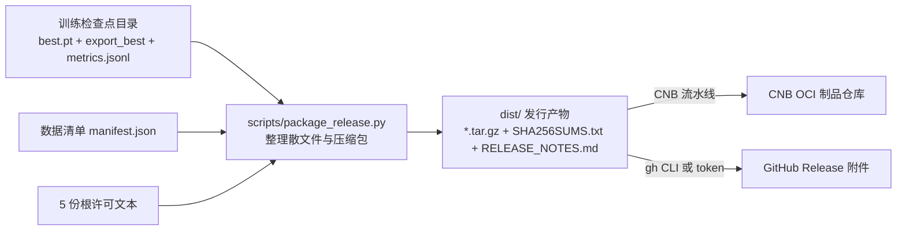

# 开源许可数据、训练与双端发版流程

自研模型权重若夹带来源不清或附带非商业约束（例如 `CC BY-NC`）的影视或游戏爬取素材，将导致无法与 AGPLv3 开源项目配合合法分发。FrameFlow 把训练素材下载切分、领域合成增强、教师学生蒸馏以及多文件合规发版固化为一套可复现的命令行与流水线流程。

## 开放许可数据构成与防泄漏切分

仓库在 `.gitignore` 中明确隔离原始训练数据、检查点与打包产物目录，所有公开数据源及其许可归属在构建前记录入清单：
- **插帧数据源**（[插帧数据脚本](../../scripts/prepare_data.py)）：使用可断点续传拉取的开源电影与广播测试序列（Blender `CC-BY 3.0` 与 Xiph/SVT 开放测试序列），并允许开发者在本地私有用目录下补充自有录制片段。提取三连帧时同时计算帧差直方图与黑帧阈值，严格防止训练三元组跨越硬切镜头或停留在纯黑过渡画面。
- **超分数据源**（[超分数据脚本](../../scripts/prepare_sr_data.py)）：除开放高清影视截帧外，混入 MIT 许可的合成线稿集以及本地矢量字体引擎即时渲染的中日英游戏介面状态栏文字卡片，专门缓解普通自然图像超分在模拟器像素 UI 与文字边缘上产生的糊化或振铃。
- **确定性哈希切分**：所有样本按来源标识或序列键哈希到训练集与验证集，默认按 95% 与 5% 划分，从数据源层面杜绝同一镜头相邻帧跨集合泄漏。

## 游戏画面特性针对性训练损失与增强

游戏画面区别于普通实拍视频的难点在于静态叠加血条与小地图在运动物体前方完全静止。若不针对性处理，光流模型会把背景运动拖曳到前景血条上造成重影撕裂：
- **静态 UI 叠加与零光流监督**：插帧数据集通过 `overlay_synthetic_hud` 在输入三连帧同一位置以完全一致的像素贴上程序生成血条、分值牌或小地图，同时返回精确的二值遮罩。损失函数对命中遮罩区域单独施加零光流惩罚与更高的像素保真权重。
- **教师到轻量学生蒸馏**：先以大容量的 `GameFI-Std` 或 `GameSR-Std` 收敛为基准教师，再冻结教师权重并启用知识蒸馏项引导 `GameFI-Lite` 或 `GameSR-Lite` 学习运动边界与细节锐化，压缩七成参数量后仍能保留近似的轮廓表现。

对应源码：[数据集生成](../../frameflow/dataset.py)、[插帧损失](../../frameflow/losses.py) 与 [超分损失](../../frameflow/sr_losses.py)。

## 打包发版流水线与合规随包物边界

训练完毕并在检查点目录自动写出最优验证导出后，`package_release.py` 负责组装最终发布产物，保证无论从 GitHub Release 还是 CNB OCI 仓库获取权重压缩包，消费者均收到一致的许可依据与哈希校验凭据：

每份生成压缩包内置七类内容：`graph.json`、`model.json`、`model.bin`、仓库根目录全部五份许可证与附加条款文件、数据来源清单 `DATA_PROVENANCE.json` 以及训练指标流水 `metrics.jsonl`，并在同级目录输出覆盖全部发布文件的 `SHA256SUMS.txt`。双端云平台配置（`.cnb.yml`、`.cnb/web_trigger.yml` 及 `.github/workflows/train-and-release.yml`）复用上述完全相同的打包命令，差异仅在于云平台默认产出直传 OCI 制品或 Workflow 产物并在显式指定发布标签时追加外部 Release。

对应源码：[发版打包脚本](../../scripts/package_release.py)、[GitHub 发布脚本](../../scripts/publish_github_release.sh) 与 [双端训练文档](../../docs/TRAINING.md)。

证据状态：除特别标注外，本页基于当前源码已确认；云端耗时数据估算援引自原训练指引，具体机器视显卡与数据规模而定。
