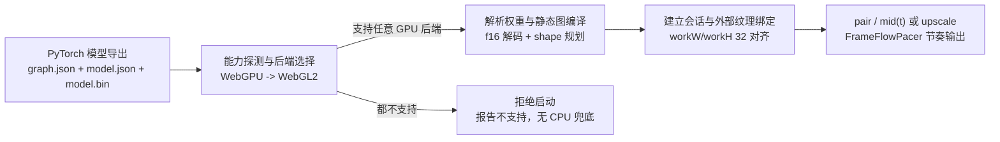

# FrameFlow：一次真实主流程

浏览器端运行光流插帧或实时超分时，需要把训练端导出的模型产物完整交给前端引擎，在不阻塞模拟器渲染线程的前提下选定计算后端并持续调度输出帧。本页沿权重导出、引擎创建、会话建立、逐帧执行与能力拒绝这条交接主线展开。

难点在于模型权重以十六位半精度紧凑存放，静态算子图同时驱动计算着色器与片元着色器两条后端，且热路径不允许从显存同步回读像素或拖垮宿主模拟器帧率；一旦模型清单缺失张量、算子版本不匹配或浏览器缺少浮点渲染目标支持，系统必须明确拒绝而不是静默退化为占用主线程的软推理。

下面表格汇总依据源码分支梳理的代表性输入与交接结果：

| 输入或状态 | 动作与结果 |
| --- | --- |
| 完整模型产物且浏览器支持 WebGPU（含半精度扩展） | 启用计算着色器后端并按需开启十六位计算通道 |
| 无可用 WebGPU，但浏览器支持 WebGL2 与浮点/半浮点纹理渲染目标 | 自动降级为片元着色器多渲染目标路径，不抛出终端错误 |
| WebGPU 与 WebGL2 半浮点/浮点渲染目标均不可用 | 直接报告不支持并终止会话创建，不提供软件计算兜底 |
| 算子图引用缺失权重的张量或版本号不为 1 | 在校验阶段立即抛出异常，阻止不完整图结构进入显存分配 |

## Step 1: 从 PyTorch 模型导出统一格式产物

训练完成或测试构造的插帧模型与超分模型首先被导出为同一套三文件描述：静态算子拓扑、张量清单偏移表与小端序十六位半精度权重二进制文件，统一标记格式版本为 1，并以蓝绿红三通道顺序约定图像输入。插帧图导出时会写入四分之一降采样编码分支、多半径代价体与时间调制多层感知机参数；超分图导出则写入残差体卷积序列与像素重排上采样终节点。

[插帧导出实现](../../frameflow/export.py) 定位 `build_graph_json`、`export_model`；[超分导出实现](../../frameflow/sr_export.py) 定位 `build_sr_graph_json`、`export_sr_model`。

## Step 2: 探测浏览器图形能力并创建引擎

宿主应用或模拟器在接入时先调用能力探测或自动引擎工厂，优先尝试计算着色器后端并在可用时申请半精度扩展；若当前浏览器环境不开放 WebGPU 或创建设备失败，则顺序尝试初始化 WebGL2 上下文。如果浏览器连半浮点/浮点帧缓冲扩展都不具备，两条路径都会返回明确失败信息并停止继续分配纹理资源，避免浏览器或模拟器因软推理出现卡顿。

[运行时统一入口](../../runtime/index.js) 定位 `probeCapabilities`、`createFrameFlow`、`loadModelFromUrl`；[接口类型声明](../../runtime/types.d.ts) 定位 `FrameFlowCreateOptions`、`BackendKind`。

## Step 3: 解析半精度权重并校验静态图与工作尺寸

拿到模型文件后，加载器先检查版本号是否等于 1、二进制字节长度是否为偶数，再把十六位无符号整数视图解码为三十二位浮点阵列并建立索引表，逐一核对计算图中每个权重引用是否真实存在。任何越界偏移、缺失张量或非正整数维度都会在此处抛出异常终止加载。随后静态规划器展开循环次数并推算所有中间张量的二维尺寸，其中插帧工作分辨率会通过向上取整约束到三十二的整数倍。

[模型解析与规划实现](../../runtime/loader.js) 定位 `parseModel`、`compilePlan`、`f16ToF32`、`align32`。

## Step 4: 绑定外部纹理或上传输入并编译单批次执行链

在集成网页模拟器时，宿主可以把自家的图形设备或渲染上下文传入引擎，并通过外部纹理挂载接口直接绑定原生游戏输出纹理；单独使用普通网页画布时，也可直接写入像素或画布对象。计算后端依据规划表一次性预分配缓冲与纹理数组，把像素归一化、编码、光流推定、遮罩合成或二倍残差叠加编码为单次或成对命令提交，其中片元后端严格使用自上而下坐标系与 PyTorch 网格采样语义保持数值一致。

[计算着色器后端](../../runtime/webgpu-backend.js) 定位 `makeShaders`、`WebGPUEngine`；[片元着色器后端](../../runtime/webgl2-backend.js) 定位 `WebGL2Engine`、`FS_TEX_IN`。

## Step 5: 使用无阻塞节拍器调度原帧与生成帧输出

对于二倍或三倍插帧工作流，游戏每产生一帧真实画面时只推进环形槽位索引并计算平滑帧间隔指数滑动平均，按相位点生成中间帧任务并放入输出队列；展示循环按单调递增时间戳决定当前输出原生帧还是已就绪中间帧，若主机掉帧导致队列积压超过上限，节拍器直接丢弃陈旧队列项以守住实时性。整条热路径只在明确调用回读接口或执行单元测试时才将结果拷贝回内存，正常游玩过程不插入阻塞式同步等待。

[帧节拍调度器](../../runtime/pacer.js) 定位 `FrameFlowPacer`、`onSourceFrame`、`tick`；[节点单元测试](../../tests/test_runtime_node.mjs) 定位 `FrameFlowPacer` 调度用例。

## 下一步与验证入口

要修改导出算子或前端后端调度，继续查看[按职责找代码](../code-map.md)；如需排查半精度解码或共享纹理生命周期，参阅[WebGPU 与 WebGL2 双后端运行时](../modules/dual-backend-runtime.md)。

可通过仓库根目录下的 `make test` 执行纯 CPU 导出与节点调度验证；需要核对真实着色器数值对齐时，另行在具备可用 GPU 驱动的环境执行 `scripts/verify_backends.py` 与 `scripts/verify_sr_backends.py`。

证据状态：除特别标注外，本页基于当前源码已确认。
